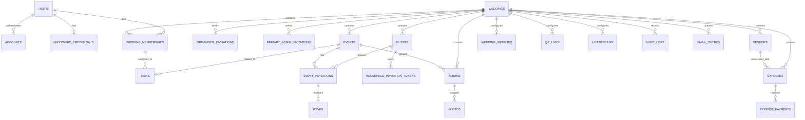

# Make My Marriage
# Database Design Document (DDD)

**Version:** 1.1  
**Status:** Final – Approved Database Design Baseline  
**Product:** Make My Marriage  
**Baseline Date:** 4 November 2026  
**Database:** MongoDB Atlas  
**ODM:** Mongoose  
**Backend:** Next.js / Node.js / TypeScript  
**Architecture:** Modular Monolith  
**Currency:** INR – whole rupees only  
**Default Timezone:** Asia/Kolkata

---

# 1. Document Purpose

This document defines the database design for the Make My Marriage MVP.

It translates the approved Product Requirements Document (PRD) v1.1 and System Architecture Document into an implementation-ready MongoDB data model.

It defines:

- Database collections and their responsibilities.
- Document structures and field definitions.
- Data types and validation requirements.
- Relationships and reference strategies.
- Indexes and uniqueness constraints.
- Organiser membership and authorisation data.
- Wedding, event, task, guest, and RSVP data.
- Expenses and permanent payment history.
- Vendor and wedding website data.
- Photo gallery, QR links, and livestream configuration.
- Email delivery and audit records.
- Data integrity, transaction, and concurrency requirements.
- Data lifecycle and event-deletion behaviour.

This document is the database implementation reference for the MVP.

It does not replace the PRD or System Architecture Document.

## 1.1 Authority hierarchy

In case of conflicting requirements, follow this order:

1. **PRD v1.1:** Authoritative product requirements.
2. **Approved System Architecture Document:** Authoritative system architecture and technology decisions.
3. **This DDD v1.1:** Authoritative database implementation design.

## 1.2 Database design principles

1. Use MongoDB collections for independently managed domain entities.
2. Use ObjectId references for relationships between independently managed records.
3. Embed only bounded data that naturally belongs to a parent document.
4. Every wedding-owned record must be scoped to its wedding.
5. Enforce critical constraints through database indexes and server-side application logic.
6. Never rely exclusively on frontend validation.
7. Store all financial amounts as integer INR values.
8. Never physically delete payment records.
9. Preserve financial and audit history.
10. Store invitation and QR tokens as hashes, never plaintext.
11. Keep organiser access separate from guest-facing access.
12. Use soft deletion where historical traceability is required.
13. Do not introduce database entities for features outside the approved MVP scope.

---

# 2. Technology and Database Configuration

## 2.1 Database

**MongoDB Atlas**

MongoDB is the primary database for application data.

## 2.2 ODM

**Mongoose**

Mongoose is responsible for:

- Schema definitions.
- Field validation.
- Document creation and updates.
- References and population.
- Index definitions.
- Model middleware where appropriate.
- Transaction support using MongoDB sessions.

## 2.3 Identifier strategy

All application-managed documents use MongoDB ObjectId identifiers.

| Field | Type | Description |
|---|---|---|
| `_id` | ObjectId | Unique document identifier |

Foreign references should also use ObjectId.

Application APIs may expose ObjectIds as strings, but persistence should use ObjectId values.

## 2.4 Common fields

Applicable domain collections should use Mongoose timestamps.

| Field | Type | Description |
|---|---|---|
| `_id` | ObjectId | Document identifier |
| `createdAt` | Date | Creation timestamp |
| `updatedAt` | Date | Last update timestamp |

Additional fields such as `createdBy`, `updatedBy`, `deletedAt`, and `deletedBy` should be included where appropriate.

Do not add lifecycle or audit fields indiscriminately to every technical collection.

---

# 3. Collection Inventory

The MVP database contains the following 25 collections.

| No. | Collection | Responsibility |
|---:|---|---|
| 1 | `users` | User profile and identity |
| 2 | `accounts` | Auth.js authentication provider accounts |
| 3 | `passwordCredentials` | Email/password credentials |
| 4 | `verificationTokens` | Email verification tokens |
| 5 | `passwordResetTokens` | Password recovery tokens |
| 6 | `weddings` | Wedding workspace |
| 7 | `weddingMemberships` | Organiser membership and role |
| 8 | `organiserInvitations` | Additional organiser invitations |
| 9 | `primaryAdminInvitations` | Partner Primary Admin invitation |
| 10 | `events` | Wedding events |
| 11 | `tasks` | Wedding planning tasks |
| 12 | `guests` | Guest households |
| 13 | `eventInvitations` | Household invitations for individual events |
| 14 | `householdInvitationTokens` | Household invitation link tokens |
| 15 | `rsvps` | Household RSVP responses |
| 16 | `expenses` | Wedding expenses |
| 17 | `expensePayments` | Permanent payment records |
| 18 | `vendors` | Wedding vendors |
| 19 | `weddingWebsites` | Wedding website configuration and content |
| 20 | `albums` | Event-based photo albums |
| 21 | `photos` | Uploaded and published photo metadata |
| 22 | `qrLinks` | Gallery-view and guest-upload QR links |
| 23 | `livestreams` | YouTube livestream configuration |
| 24 | `emailOutbox` | Transactional email delivery queue |
| 25 | `auditLogs` | Activity and change history |

The collections are separated to support independent lifecycle management, indexing, access control, and maintenance.

---

# 4. Identity and Authentication Collections

## 4.1 `users`

### Purpose

Stores the application's user profile and primary identity information.

A user can have only one active wedding membership at a time.

Guests are represented as households, not user accounts.

### Schema

| Field | Type | Required | Description |
|---|---|---:|---|
| `_id` | ObjectId | Yes | User identifier |
| `name` | String | Yes | Display name |
| `email` | String | Yes | Normalized email |
| `emailVerified` | Date / Null | No | Verification timestamp |
| `image` | String / Null | No | Profile image URL |
| `status` | String | Yes | ACTIVE or DISABLED |
| `createdAt` | Date | Yes | Creation timestamp |
| `updatedAt` | Date | Yes | Update timestamp |

### Rules

- Normalize email addresses before persistence.
- Email must be unique.
- A disabled user cannot access organiser functionality.
- Email verification is required for both Google and email/password authentication flows.
- Removing an organiser membership does not delete the user account.

### Indexes

| Index | Type |
|---|---|
| `{ email: 1 }` | Unique |
| `{ status: 1 }` | Standard |

---

## 4.2 `accounts`

### Purpose

Stores OAuth provider account information through the Auth.js adapter.

### Schema

| Field | Type | Required | Description |
|---|---|---:|---|
| `_id` | ObjectId | Yes | Account identifier |
| `userId` | ObjectId | Yes | Reference to `users` |
| `type` | String | Yes | Auth.js account type |
| `provider` | String | Yes | OAuth provider |
| `providerAccountId` | String | Yes | Provider account identifier |
| `refresh_token` | String / Null | No | OAuth refresh token |
| `access_token` | String / Null | No | OAuth access token |
| `expires_at` | Number / Null | No | Token expiry |
| `token_type` | String / Null | No | Token type |
| `scope` | String / Null | No | Granted scope |
| `id_token` | String / Null | No | Provider ID token |
| `session_state` | String / Null | No | Provider session state |

The actual Auth.js adapter schema must be followed for compatibility. Optional provider fields may be absent.

### Indexes

- Unique `{ provider: 1, providerAccountId: 1 }`.
- `{ userId: 1 }`.

### Rules

- One provider account identity cannot be linked to multiple users.
- Every account must reference an existing user.
- OAuth tokens must not be exposed through normal user APIs.

---

## 4.3 `passwordCredentials`

### Purpose

Stores email/password credentials separately from the user profile.

### Schema

| Field | Type | Required | Description |
|---|---|---:|---|
| `_id` | ObjectId | Yes | Credential identifier |
| `userId` | ObjectId | Yes | User reference |
| `passwordHash` | String | Yes | Secure password hash |
| `passwordChangedAt` | Date | Yes | Last password change |
| `createdAt` | Date | Yes | Creation timestamp |
| `updatedAt` | Date | Yes | Update timestamp |

### Rules

- Never store plaintext passwords.
- Use a strong password-hashing algorithm such as Argon2id.
- A user may have a Google account, email/password credentials, or both.
- Password recovery must not disclose whether an email address is registered.

### Indexes

- Unique `{ userId: 1 }`.

---

## 4.4 `verificationTokens`

### Purpose

Stores email verification tokens.

### Schema

| Field | Type | Required | Description |
|---|---|---:|---|
| `_id` | ObjectId | Yes | Token identifier |
| `identifier` | String | Yes | Normalized email |
| `tokenHash` | String | Yes | Hashed token |
| `expiresAt` | Date | Yes | Expiry timestamp |
| `createdAt` | Date | Yes | Creation timestamp |

### Rules

- Store token hashes only.
- Tokens must be single-use.
- Expired tokens must not verify an email.
- Successful verification updates `users.emailVerified`.
- Token consumption and verification should be atomic where possible.

### Indexes

- Unique `{ tokenHash: 1 }`.
- `{ identifier: 1 }`.
- TTL index on `{ expiresAt: 1 }`.

TTL cleanup does not replace application-level expiry validation.

---

## 4.5 `passwordResetTokens`

### Purpose

Stores password recovery tokens.

### Schema

| Field | Type | Required | Description |
|---|---|---:|---|
| `_id` | ObjectId | Yes | Token identifier |
| `userId` | ObjectId | Yes | User reference |
| `tokenHash` | String | Yes | Hashed reset token |
| `expiresAt` | Date | Yes | Expiry timestamp |
| `usedAt` | Date / Null | No | Consumption timestamp |
| `createdAt` | Date | Yes | Creation timestamp |

### Rules

- Store only token hashes.
- Tokens must be single-use.
- Expired or consumed tokens cannot be reused.
- Successful reset updates the password hash and password-change timestamp.

### Indexes

- Unique `{ tokenHash: 1 }`.
- `{ userId: 1, createdAt: -1 }`.
- TTL `{ expiresAt: 1 }`.

---

# 5. Wedding Workspace Collections

## 5.1 `weddings`

### Purpose

Represents one wedding workspace.

It is the root ownership boundary for wedding-specific data.

### Schema

| Field | Type | Required | Description |
|---|---|---:|---|
| `_id` | ObjectId | Yes | Wedding identifier |
| `name` | String | Yes | Wedding display name |
| `slug` | String | Yes | Unique URL identifier |
| `createdBy` | ObjectId | Yes | Creator user reference |
| `setupStatus` | String | Yes | SETUP or ACTIVE |
| `guestAccessStatus` | String | Yes | NOT_STARTED or ACTIVE |
| `timezone` | String | Yes | Wedding timezone |
| `currency` | String | Yes | INR |
| `defaultLanguage` | String | Yes | Default guest-facing language |
| `createdAt` | Date | Yes | Creation timestamp |
| `updatedAt` | Date | Yes | Update timestamp |

### Rules

- Only Bride or Groom may initiate wedding creation.
- The creator immediately becomes a protected Primary Admin.
- The creator invites their partner through a dedicated Primary Admin invitation.
- The second Primary Admin becomes active only after invitation acceptance.
- Exactly two Primary Admin positions exist:
  - PRIMARY_BRIDE
  - PRIMARY_GROOM
- Both Primary Admins have the `ADMIN` role.
- `setupStatus` becomes ACTIVE only after both Primary Admin memberships are active.
- Guest access lifecycle is separate from organiser setup lifecycle.
- Guest access does not automatically expire after the final event.
- No wedding archive/unarchive feature is included in the MVP.
- Default timezone is Asia/Kolkata.
- Currency is INR.

### Indexes

| Index | Type | Purpose |
|---|---|---|
| `{ slug: 1 }` | Unique | Unique wedding URL |
| `{ createdBy: 1 }` | Standard | Creator lookup |
| `{ setupStatus: 1 }` | Standard | Setup queries |
| `{ guestAccessStatus: 1 }` | Standard | Guest access queries |

The slug is an identifier, not an authorisation secret.

---

## 5.2 `weddingMemberships`

### Purpose

Represents an organiser's membership in a wedding.

This collection is the source of truth for organiser access and role-based authorisation.

### Schema

| Field | Type | Required | Description |
|---|---|---:|---|
| `_id` | ObjectId | Yes | Membership identifier |
| `weddingId` | ObjectId | Yes | Wedding reference |
| `userId` | ObjectId | Yes | User reference |
| `role` | String | Yes | ADMIN or MANAGER |
| `membershipType` | String | Yes | PRIMARY_ADMIN or ADDITIONAL |
| `primaryPosition` | String / Null | No | PRIMARY_BRIDE or PRIMARY_GROOM |
| `status` | String | Yes | ACTIVE or REMOVED |
| `joinedAt` | Date | Yes | Activation timestamp |
| `removedAt` | Date / Null | No | Removal timestamp |
| `removedBy` | ObjectId / Null | No | Removing Admin |
| `createdAt` | Date | Yes | Creation timestamp |
| `updatedAt` | Date | Yes | Update timestamp |

### Primary Admin rules

A Primary Admin must have:

- `role = ADMIN`
- `membershipType = PRIMARY_ADMIN`
- `primaryPosition = PRIMARY_BRIDE` or `PRIMARY_GROOM`

Primary Admin memberships are protected from ordinary removal or demotion.

### Additional organiser rules

An additional organiser must have:

- `membershipType = ADDITIONAL`
- `primaryPosition = null`
- `role = ADMIN` or `MANAGER`

### Integrity constraints

1. A user can have only one ACTIVE wedding membership at a time.
2. A wedding can have at most one active PRIMARY_BRIDE membership.
3. A wedding can have at most one active PRIMARY_GROOM membership.
4. Both Primary Admin memberships must use role ADMIN.
5. Primary Admin memberships cannot be ordinarily removed or demoted.
6. Managers cannot manage organiser memberships.
7. Removed organisers immediately lose access.
8. Membership history remains preserved.
9. A removed additional organiser can join another wedding once their previous membership is inactive.

### Indexes

| Index | Type |
|---|---|
| `{ userId: 1, status: 1 }` | Partial unique for ACTIVE memberships |
| `{ weddingId: 1, userId: 1 }` | Query support |
| `{ weddingId: 1, membershipType: 1, primaryPosition: 1 }` | Partial unique for active primary positions |
| `{ weddingId: 1, role: 1, status: 1 }` | Organiser listing |

Use partial unique indexes for active membership constraints.

The application must also handle concurrent membership creation safely.

---

## 5.3 `organiserInvitations`

### Purpose

Stores invitations sent to additional organisers.

### Schema

| Field | Type | Required | Description |
|---|---|---:|---|
| `_id` | ObjectId | Yes | Invitation identifier |
| `weddingId` | ObjectId | Yes | Wedding reference |
| `email` | String | Yes | Normalized invitee email |
| `role` | String | Yes | ADMIN or MANAGER |
| `tokenHash` | String | Yes | Hashed invitation token |
| `status` | String | Yes | PENDING, ACCEPTED, REVOKED, EXPIRED |
| `invitedBy` | ObjectId | Yes | Inviting Admin |
| `expiresAt` | Date | Yes | Expiry timestamp |
| `acceptedAt` | Date / Null | No | Acceptance timestamp |
| `revokedAt` | Date / Null | No | Revocation timestamp |
| `createdAt` | Date | Yes | Creation timestamp |
| `updatedAt` | Date | Yes | Update timestamp |

### Rules

- Only an active Admin may invite additional organisers.
- Managers cannot invite, remove, or change organiser roles.
- Pending invitations do not grant access.
- The invitee must authenticate and satisfy email verification requirements.
- Acceptance creates an active `weddingMemberships` record.
- Acceptance must check the one-active-membership-per-user constraint.
- Tokens must be hashed.
- Invitations must be revocable and expire.

### Indexes

- Unique `{ tokenHash: 1 }`.
- `{ weddingId: 1, status: 1 }`.
- `{ email: 1, status: 1 }`.
- `{ expiresAt: 1 }`.

---

## 5.4 `primaryAdminInvitations`

### Purpose

Stores the dedicated invitation for the second Primary Admin.

This collection is separate from additional organiser invitations because accepting it creates a protected Primary Admin membership.

### Schema

| Field | Type | Required | Description |
|---|---|---:|---|
| `_id` | ObjectId | Yes | Invitation identifier |
| `weddingId` | ObjectId | Yes | Wedding reference |
| `email` | String | Yes | Partner email |
| `primaryPosition` | String | Yes | Complementary primary position |
| `tokenHash` | String | Yes | Hashed invitation token |
| `status` | String | Yes | PENDING, ACCEPTED, REVOKED, EXPIRED |
| `invitedBy` | ObjectId | Yes | Creator reference |
| `expiresAt` | Date | Yes | Expiry timestamp |
| `acceptedAt` | Date / Null | No | Acceptance timestamp |
| `createdAt` | Date | Yes | Creation timestamp |
| `updatedAt` | Date | Yes | Update timestamp |

### Rules

- The creator receives one Primary Admin position.
- The partner invitation targets the complementary position.
- Acceptance creates the second protected Primary Admin membership.
- The partner receives `role = ADMIN` and `membershipType = PRIMARY_ADMIN`.
- A primary position cannot be assigned twice.
- The invitation cannot create an ordinary additional organiser membership.

### Indexes

- Unique `{ tokenHash: 1 }`.
- `{ weddingId: 1, status: 1 }`.
- `{ email: 1, status: 1 }`.

---

# 6. Event and Task Collections

## 6.1 `events`

### Purpose

Stores wedding events, ceremonies, functions, and celebrations.

### Schema

| Field | Type | Required | Description |
|---|---|---:|---|
| `_id` | ObjectId | Yes | Event identifier |
| `weddingId` | ObjectId | Yes | Wedding reference |
| `name` | String | Yes | Event name |
| `description` | String / Null | No | Event description |
| `eventDate` | Date | Yes | Event date/time |
| `endDate` | Date / Null | No | Optional end date/time |
| `venueName` | String / Null | No | Venue name |
| `venueAddress` | String / Null | No | Venue address |
| `status` | String | Yes | ACTIVE or DELETED |
| `createdBy` | ObjectId | Yes | Creator |
| `updatedBy` | ObjectId | Yes | Last updater |
| `deletedAt` | Date / Null | No | Tombstone timestamp |
| `deletedBy` | ObjectId / Null | No | Deleting Admin |
| `deletionReason` | String / Null | No | Optional reason |
| `createdAt` | Date | Yes | Creation timestamp |
| `updatedAt` | Date | Yes | Update timestamp |

### Rules

- Every event belongs to one wedding.
- Events cannot be accessed across wedding boundaries.
- Admins can delete events.
- Managers can create and edit events but cannot delete them.
- Event deletion uses a tombstone.
- Deleted events are excluded from active event lists, public website event displays, and RSVP submissions.
- Historical references remain valid.

### Indexes

- `{ weddingId: 1, status: 1, eventDate: 1 }`.
- `{ weddingId: 1, eventDate: 1 }`.
- `{ weddingId: 1, deletedAt: 1 }`.

---

## 6.2 `tasks`

### Purpose

Stores wedding planning tasks.

### Schema

| Field | Type | Required | Description |
|---|---|---:|---|
| `_id` | ObjectId | Yes | Task identifier |
| `weddingId` | ObjectId | Yes | Wedding reference |
| `eventId` | ObjectId / Null | No | Related event |
| `title` | String | Yes | Task title |
| `description` | String / Null | No | Task description |
| `status` | String | Yes | TODO, IN_PROGRESS, COMPLETED |
| `priority` | String | Yes | LOW, MEDIUM, HIGH |
| `dueDate` | Date / Null | No | Due date |
| `assignedToMembershipId` | ObjectId / Null | No | Reference to `weddingMemberships` |
| `createdBy` | ObjectId | Yes | Creator |
| `updatedBy` | ObjectId | Yes | Last updater |
| `deletedAt` | Date / Null | No | Soft deletion timestamp |
| `deletedBy` | ObjectId / Null | No | Deleting Admin |
| `createdAt` | Date | Yes | Creation timestamp |
| `updatedAt` | Date | Yes | Update timestamp |

### Task assignment design

Task assignment references `weddingMemberships`, not `users`.

This ensures that an assignment is associated with an organiser's membership in a specific wedding.

### Rules

- Tasks belong to one wedding.
- A task may be wedding-wide or associated with an event.
- The assigned membership must belong to the same wedding.
- Only an active organiser membership can receive a new assignment.
- When an organiser is removed, their membership remains as historical data.
- Tasks assigned to a removed organiser retain the membership reference for history.
- The system must not treat a removed organiser as an active assignee.
- Admins may reassign tasks to another active membership.
- Tasks linked to a deleted event retain their event reference.
- Admins may reassign those tasks to another active event or leave them unassigned.
- Managers can create and edit tasks but cannot delete them.

### Indexes

- `{ weddingId: 1, status: 1, dueDate: 1 }`.
- `{ weddingId: 1, eventId: 1 }`.
- `{ weddingId: 1, assignedToMembershipId: 1, status: 1 }`.

---

# 7. Guest and RSVP Collections

## 7.1 `guests`

### Purpose

Represents a household, which is the invitation and RSVP unit.

A household is not an application user account.

### Schema

| Field | Type | Required | Description |
|---|---|---:|---|
| `_id` | ObjectId | Yes | Household identifier |
| `weddingId` | ObjectId | Yes | Wedding reference |
| `householdName` | String | Yes | Household display name |
| `primaryContactName` | String | Yes | Primary invitee name |
| `email` | String / Null | No | Household contact email |
| `phone` | String / Null | No | Household contact phone |
| `notes` | String / Null | No | Organiser-only notes |
| `status` | String | Yes | ACTIVE or DELETED |
| `createdBy` | ObjectId | Yes | Creator |
| `updatedBy` | ObjectId | Yes | Last updater |
| `deletedAt` | Date / Null | No | Soft deletion timestamp |
| `createdAt` | Date | Yes | Creation timestamp |
| `updatedAt` | Date | Yes | Update timestamp |

### Rules

- A household belongs to one wedding.
- A household can be invited to multiple events.
- Guest accounts are not created.
- Guest OTP is not required.
- Household contact information is private organiser data.
- Contact information and private notes must not appear in public website or gallery responses.

### Indexes

- `{ weddingId: 1, status: 1 }`.
- `{ weddingId: 1, email: 1 }`.
- `{ weddingId: 1, householdName: 1 }`.

---

## 7.2 `eventInvitations`

### Purpose

Connects a household to an individual event and defines its invitation allowance.

### Schema

| Field | Type | Required | Description |
|---|---|---:|---|
| `_id` | ObjectId | Yes | Invitation identifier |
| `weddingId` | ObjectId | Yes | Wedding reference |
| `eventId` | ObjectId | Yes | Event reference |
| `guestId` | ObjectId | Yes | Household reference |
| `maxPartySize` | Number | Yes | Maximum permitted attendees |
| `rsvpCutoffAt` | Date / Null | No | Optional RSVP deadline |
| `status` | String | Yes | ACTIVE or CANCELLED |
| `createdBy` | ObjectId | Yes | Creator |
| `createdAt` | Date | Yes | Creation timestamp |
| `updatedAt` | Date | Yes | Update timestamp |

### Rules

- A household can have at most one active invitation per event.
- `maxPartySize` must be a positive integer.
- `maxPartySize` includes the primary invitee.
- The household invitation link covers all assigned events.
- A separate token is not created for every event.
- Deleted events close their active event invitations.
- Existing RSVP records remain preserved.

### Indexes

- Unique partial `{ weddingId: 1, eventId: 1, guestId: 1 }` for active invitations.
- `{ weddingId: 1, guestId: 1, status: 1 }`.
- `{ weddingId: 1, eventId: 1, status: 1 }`.

---

## 7.3 `householdInvitationTokens`

### Purpose

Stores the secure invitation link token for a household.

One link covers all events assigned to that household.

### Schema

| Field | Type | Required | Description |
|---|---|---:|---|
| `_id` | ObjectId | Yes | Token record identifier |
| `weddingId` | ObjectId | Yes | Wedding reference |
| `guestId` | ObjectId | Yes | Household reference |
| `tokenHash` | String | Yes | Hashed token |
| `status` | String | Yes | ACTIVE or REVOKED |
| `createdBy` | ObjectId | Yes | Creating organiser |
| `revokedAt` | Date / Null | No | Revocation timestamp |
| `revokedBy` | ObjectId / Null | No | Revoking Admin |
| `createdAt` | Date | Yes | Creation timestamp |
| `updatedAt` | Date | Yes | Update timestamp |

### Rules

- Generate tokens using cryptographically secure randomness.
- Store SHA-256 hashes, not raw tokens.
- One household can have at most one active invitation token.
- Admins can revoke and regenerate the link.
- The token authorises access to the household's assigned event invitation and RSVP flow only.
- It does not grant organiser access.
- It does not grant gallery-view or upload permissions.
- The PRD does not require automatic token expiry. Do not introduce an arbitrary TTL as a product rule.
- Revocation must take effect immediately.

### Indexes

- Unique `{ tokenHash: 1 }`.
- Unique partial `{ weddingId: 1, guestId: 1 }` for ACTIVE tokens.
- `{ weddingId: 1, guestId: 1, status: 1 }`.

---

## 7.4 `rsvps`

### Purpose

Stores one RSVP response per household per event.

### Schema

| Field | Type | Required | Description |
|---|---|---:|---|
| `_id` | ObjectId | Yes | RSVP identifier |
| `weddingId` | ObjectId | Yes | Wedding reference |
| `eventId` | ObjectId | Yes | Event reference |
| `guestId` | ObjectId | Yes | Household reference |
| `eventInvitationId` | ObjectId | Yes | Invitation reference |
| `responseStatus` | String | Yes | PENDING or RESPONDED |
| `primaryAttending` | Boolean | Yes | Primary invitee attendance |
| `additionalAttendees` | Number | Yes | Additional attendee count |
| `respondedAt` | Date / Null | No | Response timestamp |
| `lastUpdatedAt` | Date / Null | No | Last response update |
| `createdAt` | Date | Yes | Creation timestamp |
| `updatedAt` | Date | Yes | Update timestamp |

### RSVP rules

- One RSVP document per household-event invitation.
- `additionalAttendees` is an integer count, not a list of individual guest records.
- `primaryAttending` is independent of `additionalAttendees`.
- The primary invitee may decline while additional household members attend.
- `additionalAttendees` must be a non-negative integer.
- Attendance must respect the event invitation's maximum party size.

### Attendance calculation

When the primary invitee attends:

`totalAttendees = 1 + additionalAttendees`

When the primary invitee does not attend:

`totalAttendees = additionalAttendees`

### Party-size validation

If the primary invitee attends:

`additionalAttendees <= maxPartySize - 1`

If the primary invitee does not attend:

`additionalAttendees <= maxPartySize`

### Additional rules

- Pending responses must be distinguishable from submitted responses.
- RSVP submissions require an active event invitation.
- RSVP updates are blocked after the configured cutoff, if one exists.
- Cancelled invitations cannot accept new RSVP responses.
- Deleted events cannot accept new RSVP responses.

### Indexes

- Unique `{ weddingId: 1, eventId: 1, guestId: 1 }`.
- `{ weddingId: 1, eventId: 1, responseStatus: 1 }`.
- `{ weddingId: 1, guestId: 1 }`.

---

# 8. Expense and Payment Collections

## 8.1 `expenses`

### Purpose

Stores individual wedding expenses.

Expense records are separate from vendor records.

### Schema

| Field | Type | Required | Description |
|---|---|---:|---|
| `_id` | ObjectId | Yes | Expense identifier |
| `weddingId` | ObjectId | Yes | Wedding reference |
| `eventId` | ObjectId / Null | No | Associated event |
| `vendorId` | ObjectId / Null | No | Associated vendor |
| `title` | String | Yes | Expense title |
| `description` | String / Null | No | Description |
| `category` | String | Yes | Expense category |
| `totalAmount` | Number | Yes | Total amount in INR |
| `expenseDate` | Date | Yes | Expense date |
| `status` | String | Yes | ACTIVE or DELETED |
| `createdBy` | ObjectId | Yes | Creator |
| `updatedBy` | ObjectId | Yes | Last updater |
| `deletedAt` | Date / Null | No | Soft deletion timestamp |
| `deletedBy` | ObjectId / Null | No | Deleting Admin |
| `createdAt` | Date | Yes | Creation timestamp |
| `updatedAt` | Date | Yes | Update timestamp |

### Financial rules

- Currency is INR.
- All amounts are stored as integer rupees.
- Paise and fractional rupee values are not supported.
- `totalAmount` must be a positive integer.
- An expense may have zero or more payment records.
- Paid-to-date is calculated from active payments.
- Outstanding is calculated from expense total minus paid-to-date.
- Managers may create and edit expenses but cannot delete them.
- Admins may delete expenses subject to payment-history integrity.
- An expense cannot be reduced below its active paid amount.
- An expense with payment history must not be physically deleted.
- Expense deletion must not cascade-delete payment records.

### Expense deletion rule

For an expense with no payment history, an Admin may soft-delete the record.

For an expense with one or more payment records, the expense must be retained as a historical financial record. It may be removed from ordinary active lists through an appropriate retained status, but its payment relationships and financial history must remain available to authorised Admins.

### Indexes

- `{ weddingId: 1, status: 1, expenseDate: -1 }`.
- `{ weddingId: 1, eventId: 1 }`.
- `{ weddingId: 1, vendorId: 1 }`.
- `{ weddingId: 1, category: 1 }`.

---

## 8.2 `expensePayments`

### Purpose

Stores individual payments made against an expense.

Payment history is permanent and must never be physically deleted.

Every payment is a separate database document.

### Schema

| Field | Type | Required | Description |
|---|---|---:|---|
| `_id` | ObjectId | Yes | Payment identifier |
| `weddingId` | ObjectId | Yes | Wedding reference |
| `expenseId` | ObjectId | Yes | Expense reference |
| `amount` | Number | Yes | Payment amount in INR |
| `paymentDate` | Date | Yes | Date of payment |
| `paymentMethod` | String | Yes | Payment method |
| `reference` | String / Null | No | Transaction/reference number |
| `notes` | String / Null | No | Payment notes |
| `status` | String | Yes | ACTIVE or VOIDED |
| `createdBy` | ObjectId | Yes | Creator |
| `updatedBy` | ObjectId | Yes | Last updater |
| `voidedAt` | Date / Null | No | Voiding timestamp |
| `voidedBy` | ObjectId / Null | No | Admin who voided it |
| `voidReason` | String / Null | No | Mandatory correction reason |
| `createdAt` | Date | Yes | Creation timestamp |
| `updatedAt` | Date | Yes | Update timestamp |

### Payment methods

Allowed values:

- CASH
- UPI
- BANK_TRANSFER
- CARD
- OTHER

### Payment statuses

| Status | Meaning | Included in paid-to-date? |
|---|---|---:|
| ACTIVE | Valid payment | Yes |
| VOIDED | Incorrect or cancelled payment retained for history | No |

### Permanent payment-history policy

Payment records must never be physically deleted.

When a payment is entered incorrectly, the correction process is:

1. An Admin reviews the payment.
2. The Admin marks it as `VOIDED`.
3. A correction reason is mandatory.
4. The original amount and payment details remain preserved.
5. `voidedAt` and `voidedBy` are recorded.
6. The voiding action is recorded in `auditLogs`.
7. The voided payment is excluded from financial calculations.
8. A correct replacement payment may be recorded separately when appropriate.

The original record must remain available to authorised Admins for historical reference.

### Permission rules

- Managers can create and edit payment records as permitted by the PRD.
- Managers cannot delete or void payment records.
- Only Admins can void a payment.
- No application role can physically delete a payment.
- Voiding a payment must not remove its original record.
- Financial correction must not be implemented by silently overwriting an incorrect payment.

### Financial calculations

`paidToDate = sum(amount of ACTIVE payments)`

`outstanding = expense.totalAmount - paidToDate`

Voided payments are excluded.

### Validation rules

- `amount` must be a positive integer.
- `paymentDate` is required.
- `paymentMethod` is required.
- `expenseId` must reference an expense belonging to the same wedding.
- Total active payments must not exceed the expense total.
- A payment cannot be voided without a reason.
- A voided payment cannot be returned to ACTIVE through ordinary functionality.
- If a replacement is needed, create a separate payment record.
- All financial changes must be audited.

### Indexes

- `{ weddingId: 1, expenseId: 1, status: 1 }`.
- `{ weddingId: 1, paymentDate: -1 }`.
- `{ expenseId: 1, createdAt: -1 }`.
- `{ weddingId: 1, status: 1, createdAt: -1 }`.

### Transaction requirements

Payment creation, editing, and voiding must use appropriate transaction and concurrency controls.

For payment creation:

1. Read the expense.
2. Calculate its active payment total.
3. Validate the proposed payment.
4. Ensure the new active total does not exceed the expense total.
5. Create the payment record.
6. Write the audit record.
7. Commit the transaction.

For payment voiding:

1. Verify that the actor is an active Admin.
2. Read the active payment.
3. Validate the mandatory void reason.
4. Change the payment status to VOIDED.
5. Record voiding metadata.
6. Write the audit record.
7. Commit the transaction.

If a transaction fails, no partial financial mutation should remain.

---

# 9. Vendor Collection

## 9.1 `vendors`

### Purpose

Stores vendors saved to a wedding workspace.

Google Places discovery results are informational and do not automatically become saved vendor records.

### Schema

| Field | Type | Required | Description |
|---|---|---:|---|
| `_id` | ObjectId | Yes | Vendor identifier |
| `weddingId` | ObjectId | Yes | Wedding reference |
| `name` | String | Yes | Vendor name |
| `category` | String | Yes | Vendor category |
| `contactPerson` | String / Null | No | Contact person |
| `phone` | String / Null | No | Contact number |
| `email` | String / Null | No | Contact email |
| `address` | String / Null | No | Vendor address |
| `website` | String / Null | No | Vendor website |
| `notes` | String / Null | No | Organiser notes |
| `googlePlaceId` | String / Null | No | External Google Place ID |
| `source` | String | Yes | MANUAL or GOOGLE_PLACES |
| `status` | String | Yes | ACTIVE or DELETED |
| `createdBy` | ObjectId | Yes | Creator |
| `updatedBy` | ObjectId | Yes | Last updater |
| `createdAt` | Date | Yes | Creation timestamp |
| `updatedAt` | Date | Yes | Update timestamp |

### Vendor categories

- Photographer
- Videographer
- Venue
- Caterer
- Decorator
- DJ
- Makeup Artist
- Mehandi Artist
- Pandit
- Choreographer
- Wedding Planner
- Florist
- Others

### Rules

- Vendors belong to one wedding.
- Vendors are separate from expenses.
- An expense may optionally reference a vendor.
- Vendor discovery does not represent endorsement, verification, booking, negotiation, or payment processing.
- Google Place IDs may be stored for saved discovery results.
- Avoid unnecessary retention of external place details.

### Indexes

- `{ weddingId: 1, status: 1, category: 1 }`.
- `{ weddingId: 1, name: 1 }`.
- Partial `{ weddingId: 1, googlePlaceId: 1 }` where present.

---

# 10. Wedding Website Collection

## 10.1 `weddingWebsites`

### Purpose

Stores website configuration and guest-facing content for a wedding.

The website is shareable and unlisted. Its URL is not an access-control boundary.

### Schema

| Field | Type | Required | Description |
|---|---|---:|---|
| `_id` | ObjectId | Yes | Website identifier |
| `weddingId` | ObjectId | Yes | Wedding reference |
| `theme` | String | Yes | Selected theme |
| `status` | String | Yes | DRAFT, PUBLISHED, UNPUBLISHED |
| `defaultLanguage` | String | Yes | EN or HI |
| `supportedLanguages` | Array | Yes | Supported languages |
| `content` | Object | Yes | Localised website content |
| `publishedAt` | Date / Null | No | Publication timestamp |
| `updatedBy` | ObjectId | Yes | Last updater |
| `createdAt` | Date | Yes | Creation timestamp |
| `updatedAt` | Date | Yes | Update timestamp |

### Theme values

- CLASSIC_INDIAN
- MINIMAL_ELEGANT
- MODERN_CELEBRATION

### Content structure

The `content` object should contain only approved guest-facing content, such as:

- Couple names.
- Welcome message.
- Wedding introduction.
- Event descriptions.
- Venue display information.
- Other supported website sections.

Localised content should be stored separately, for example:

- `content.en`
- `content.hi`

The exact content fields should follow the approved website feature requirements.

### Rules

- One website configuration per wedding.
- Only configured and published content is exposed publicly.
- Organiser-only data must never be included in public website responses.
- Website publication and unpublication are organiser-controlled.
- No automatic translation is performed.
- Guest-facing pages support English and Hindi.
- Organiser dashboard remains English.
- Website links may be forwarded.

### Indexes

- Unique `{ weddingId: 1 }`.
- `{ status: 1 }` where useful for publication queries.

---

# 11. Photo Gallery Collections

## 11.1 `albums`

### Purpose

Stores event-based photo albums.

### Schema

| Field | Type | Required | Description |
|---|---|---:|---|
| `_id` | ObjectId | Yes | Album identifier |
| `weddingId` | ObjectId | Yes | Wedding reference |
| `eventId` | ObjectId | Yes | Related event |
| `name` | String | Yes | Album name |
| `description` | String / Null | No | Album description |
| `status` | String | Yes | ACTIVE or DELETED |
| `publicationStatus` | String | Yes | DRAFT or PUBLISHED |
| `requiresReview` | Boolean | Yes | Admin review required |
| `createdBy` | ObjectId | Yes | Creator |
| `updatedBy` | ObjectId | Yes | Last updater |
| `deletedAt` | Date / Null | No | Deletion timestamp |
| `deletedBy` | ObjectId / Null | No | Deleting Admin |
| `createdAt` | Date | Yes | Creation timestamp |
| `updatedAt` | Date | Yes | Update timestamp |

### Rules

- Albums belong to one wedding and one event.
- A deleted event causes its associated album to become unpublished and require Admin review.
- Album and photo metadata remain available for historical traceability.
- Admins may review and reassign an album to another active event.
- Permanent media deletion is Admin-only.
- Published photos may be viewed and downloaded through the wedding-wide gallery link.

### Indexes

- `{ weddingId: 1, eventId: 1, status: 1 }`.
- `{ weddingId: 1, publicationStatus: 1 }`.

---

## 11.2 `photos`

### Purpose

Stores photo metadata.

Actual image files are stored in Cloudflare R2, not MongoDB.

### Schema

| Field | Type | Required | Description |
|---|---|---:|---|
| `_id` | ObjectId | Yes | Photo identifier |
| `weddingId` | ObjectId | Yes | Wedding reference |
| `albumId` | ObjectId | Yes | Album reference |
| `eventId` | ObjectId | Yes | Event reference |
| `storageKey` | String | Yes | R2 object key |
| `originalFileName` | String | Yes | Original filename |
| `mimeType` | String | Yes | Validated media type |
| `fileSize` | Number | Yes | Size in bytes |
| `width` | Number / Null | No | Image width |
| `height` | Number / Null | No | Image height |
| `status` | String | Yes | PENDING, APPROVED, REJECTED, DELETED |
| `uploadedVia` | String | Yes | ORGANISER or GUEST_UPLOAD |
| `uploadedBy` | ObjectId / Null | No | Organiser user reference |
| `moderatedBy` | ObjectId / Null | No | Moderating organiser |
| `moderatedAt` | Date / Null | No | Moderation timestamp |
| `rejectionReason` | String / Null | No | Optional reason |
| `createdAt` | Date | Yes | Upload timestamp |
| `updatedAt` | Date | Yes | Update timestamp |
| `deletedAt` | Date / Null | No | Deletion timestamp |
| `deletedBy` | ObjectId / Null | No | Deleting Admin |

### Photo statuses

| Status | Meaning |
|---|---|
| PENDING | Uploaded and awaiting moderation |
| APPROVED | Approved for publication |
| REJECTED | Rejected by a moderator |
| DELETED | Removed from active access and scheduled for storage cleanup |

### Permission rules

- Admins and Managers can approve or reject guest submissions.
- Only Admins can permanently delete photos.
- Pending photos must not be publicly accessible.
- Rejected photos must not be publicly accessible.
- Only approved photos in published albums are exposed through gallery viewing.
- Upload authorisation does not grant viewing or downloading permissions.

### Indexes

- `{ weddingId: 1, albumId: 1, status: 1, createdAt: -1 }`.
- `{ weddingId: 1, eventId: 1 }`.
- `{ weddingId: 1, status: 1, createdAt: -1 }`.
- Unique `{ storageKey: 1 }`.

---

## 11.3 `qrLinks`

### Purpose

Stores the two separate wedding-wide QR/link mechanisms:

1. Gallery-view QR.
2. Guest-upload QR.

They are separate authorisation mechanisms with different permissions.

### Schema

| Field | Type | Required | Description |
|---|---|---:|---|
| `_id` | ObjectId | Yes | QR record identifier |
| `weddingId` | ObjectId | Yes | Wedding reference |
| `type` | String | Yes | GALLERY_VIEW or GUEST_UPLOAD |
| `tokenHash` | String | Yes | Hashed secret token |
| `status` | String | Yes | ACTIVE or REVOKED |
| `createdBy` | ObjectId | Yes | Creating Admin |
| `revokedBy` | ObjectId / Null | No | Revoking Admin |
| `revokedAt` | Date / Null | No | Revocation timestamp |
| `createdAt` | Date | Yes | Creation timestamp |
| `updatedAt` | Date | Yes | Update timestamp |

### Rules

- Exactly two QR/link types are supported in the MVP.
- Both are wedding-wide.
- The upload QR is not event-specific or album-specific.
- Gallery-view and upload tokens must be independent.
- Tokens must be generated using cryptographically secure randomness.
- Store only token hashes.
- QR tokens must not act as organiser credentials.
- Gallery-view token grants access to published photos only.
- Upload token authorises photo submission only.
- Upload token does not grant gallery viewing or downloading.
- Each type has at most one active token per wedding.
- Admins can revoke and regenerate tokens.
- Revocation must take effect immediately.

### Token generation

Use 32 cryptographically secure random bytes encoded in a URL-safe format.

Store the SHA-256 hash.

Return the raw token only when the link is created or regenerated. Never log it.

### Indexes

- Unique `{ tokenHash: 1 }`.
- Unique partial `{ weddingId: 1, type: 1 }` for ACTIVE records.
- `{ weddingId: 1, type: 1, status: 1 }`.

---

# 12. Livestream Collection

## 12.1 `livestreams`

### Purpose

Stores YouTube livestream configuration.

### Schema

| Field | Type | Required | Description |
|---|---|---:|---|
| `_id` | ObjectId | Yes | Livestream identifier |
| `weddingId` | ObjectId | Yes | Wedding reference |
| `eventId` | ObjectId / Null | No | Related event |
| `youtubeUrl` | String | Yes | Submitted YouTube URL |
| `youtubeVideoId` | String | Yes | Extracted video identifier |
| `status` | String | Yes | DRAFT, PUBLISHED, UNPUBLISHED |
| `visibility` | String | Yes | PUBLIC |
| `createdBy` | ObjectId | Yes | Creator |
| `updatedBy` | ObjectId | Yes | Last updater |
| `createdAt` | Date | Yes | Creation timestamp |
| `updatedAt` | Date | Yes | Update timestamp |

### Rules

- Accept supported YouTube URLs only.
- Extract and store the validated YouTube video identifier.
- Do not embed arbitrary iframe URLs.
- Livestream visibility is PUBLIC.
- YouTube controls stream availability and privacy.
- Links may be forwarded.
- The application does not host livestreams.
- Deleting an associated event causes the livestream configuration to be unpublished or disabled.

### Indexes

- `{ weddingId: 1, status: 1 }`.
- `{ weddingId: 1, eventId: 1 }`.

---

# 13. Technical and Operational Collections

## 13.1 `emailOutbox`

### Purpose

Provides reliable email delivery for invitations, verification, password recovery, and transactional notifications.

### Schema

| Field | Type | Required | Description |
|---|---|---:|---|
| `_id` | ObjectId | Yes | Email job identifier |
| `weddingId` | ObjectId / Null | No | Related wedding |
| `recipient` | String | Yes | Recipient email |
| `template` | String | Yes | Template identifier |
| `payload` | Object | Yes | Template data |
| `status` | String | Yes | PENDING, PROCESSING, SENT, FAILED |
| `attemptCount` | Number | Yes | Delivery attempts |
| `nextAttemptAt` | Date / Null | No | Next retry time |
| `providerMessageId` | String / Null | No | Resend message identifier |
| `lastError` | String / Null | No | Sanitised error |
| `idempotencyKey` | String | Yes | Unique delivery key |
| `sentAt` | Date / Null | No | Successful delivery timestamp |
| `createdAt` | Date | Yes | Creation timestamp |
| `updatedAt` | Date | Yes | Update timestamp |

### Rules

- Use Resend for email delivery.
- Create outbox records as part of relevant database operations.
- Send emails asynchronously.
- Failed emails must be retryable.
- Retries must not create duplicate logical invitations.
- Never include plaintext passwords or unnecessary secrets in payloads.
- Avoid logging raw invitation tokens.
- Email delivery failure must not silently roll back an already committed user-facing operation.

### Indexes

- `{ status: 1, nextAttemptAt: 1, createdAt: 1 }`.
- Unique `{ idempotencyKey: 1 }`.
- `{ weddingId: 1, createdAt: -1 }`.

---

## 13.2 `auditLogs`

### Purpose

Records important operations and changes for accountability, security, and historical traceability.

### Schema

| Field | Type | Required | Description |
|---|---|---:|---|
| `_id` | ObjectId | Yes | Audit identifier |
| `weddingId` | ObjectId / Null | No | Related wedding |
| `actorUserId` | ObjectId / Null | No | Acting user |
| `actorType` | String | Yes | USER or SYSTEM |
| `action` | String | Yes | Action identifier |
| `entityType` | String | Yes | Affected entity type |
| `entityId` | ObjectId / Null | No | Affected record |
| `metadata` | Object | No | Sanitised contextual data |
| `ipHash` | String / Null | No | Optional privacy-conscious IP fingerprint |
| `userAgent` | String / Null | No | Optional user-agent information |
| `createdAt` | Date | Yes | Event timestamp |

### Important audited actions

- Wedding creation.
- Primary Admin invitation and acceptance.
- Organiser invitation, acceptance, revocation, and removal.
- Organiser role changes.
- Event deletion.
- Expense creation and modification.
- Payment creation and modification.
- Payment voiding.
- Vendor changes.
- Gallery token regeneration and revocation.
- Upload token regeneration and revocation.
- Photo approval and rejection.
- Permanent photo deletion.
- Website publication changes.
- Livestream publication changes.

### Rules

- Never log passwords, raw tokens, or unnecessary sensitive data.
- Financial changes must be auditable.
- Payment voiding must preserve the correction reason in the payment record and audit history.
- Audit records must not be editable through ordinary application functionality.
- Managers cannot delete audit records.
- Retention must follow the approved operational retention policy.

### Indexes

- `{ weddingId: 1, createdAt: -1 }`.
- `{ entityType: 1, entityId: 1, createdAt: -1 }`.
- `{ actorUserId: 1, createdAt: -1 }`.
- `{ action: 1, createdAt: -1 }`.

---

# 14. Entity Relationships

## 14.1 High-level relationship diagram



This diagram represents logical relationships. MongoDB does not automatically enforce SQL-style foreign keys.

## 14.2 Reference strategy

Use ObjectId references for:

- User-to-account relationships.
- User-to-membership relationships.
- Wedding-to-domain-record relationships.
- Membership-to-task assignments.
- Event-to-task relationships.
- Household-to-event invitation relationships.
- Expense-to-payment relationships.
- Vendor-to-expense relationships.
- Album-to-photo relationships.

Use embedding for bounded data such as:

- Website localisation content.
- Small configuration objects.
- Email template payloads.
- Sanitised audit metadata.

Do not embed unbounded collections such as payments, photos, audit logs, or invitations inside a wedding document.

---

# 15. Multi-Tenant Data Isolation

Each wedding is a separate logical tenant.

All wedding-owned collections must include `weddingId`.

Examples include:

- Events.
- Tasks.
- Guests.
- Event invitations.
- Household invitation tokens.
- RSVPs.
- Expenses.
- Payments.
- Vendors.
- Website configuration.
- Albums.
- Photos.
- QR links.
- Livestreams.
- Audit logs.

## 15.1 Query requirements

Every organiser-facing query must verify:

1. The authenticated user exists and is active.
2. The user has an active membership in the requested wedding.
3. The membership grants the requested action.
4. The target document belongs to that wedding.

Do not retrieve a document using only `_id` and assume that it belongs to the current wedding.

## 15.2 Example

```ts
Event.findOne({
  _id: eventId,
  weddingId: activeWeddingId,
  status: "ACTIVE"
});
```

Every related-record lookup must also verify wedding ownership.

For example, an expense cannot reference a vendor from another wedding, and an RSVP cannot reference an event invitation belonging to another wedding.

---

# 16. Critical Database Integrity Rules

| No. | Integrity rule |
|---:|---|
| 1 | Normalized user email must be unique. |
| 2 | One user may have only one active wedding membership. |
| 3 | Each wedding has at most one active PRIMARY_BRIDE membership. |
| 4 | Each wedding has at most one active PRIMARY_GROOM membership. |
| 5 | Both Primary Admin memberships use role ADMIN. |
| 6 | Primary Admin memberships cannot be ordinarily removed or demoted. |
| 7 | Every wedding-owned record contains its wedding reference. |
| 8 | Related records must belong to the same wedding. |
| 9 | Task assignments reference `weddingMemberships`. |
| 10 | One active household invitation exists per household-event pair. |
| 11 | One RSVP exists per household-event pair. |
| 12 | RSVP attendance respects the invitation party-size limit. |
| 13 | One active household invitation token exists per household. |
| 14 | One active gallery-view token exists per wedding. |
| 15 | One active guest-upload token exists per wedding. |
| 16 | Gallery and upload tokens are independent. |
| 17 | Expense amounts are positive integer INR values. |
| 18 | Payment amounts are positive integer INR values. |
| 19 | Active payments cannot exceed the expense total. |
| 20 | An expense cannot be reduced below its active paid amount. |
| 21 | Payment records are never physically deleted. |
| 22 | Only Admins can void payment records. |
| 23 | Voided payments retain their original details and correction reason. |
| 24 | Voided payments are excluded from paid-to-date calculations. |
| 25 | Financial changes must be audited. |
| 26 | Managers cannot delete ordinary records or void payments. |
| 27 | Managers may moderate photos but cannot permanently delete them. |
| 28 | Deleted events preserve financial and historical references. |
| 29 | Pending and rejected photos are never publicly accessible. |
| 30 | Only approved photos in published albums are publicly accessible. |
| 31 | Public responses must not expose organiser-only data. |
| 32 | Invitation and QR tokens are stored as hashes. |
| 33 | Wedding deletion is outside the current DDD scope. |

---

# 17. Indexing Strategy

Indexes must support actual query patterns.

## 17.1 Unique indexes

| Collection | Index |
|---|---|
| users | `{ email: 1 }` |
| accounts | `{ provider: 1, providerAccountId: 1 }` |
| passwordCredentials | `{ userId: 1 }` |
| verificationTokens | `{ tokenHash: 1 }` |
| passwordResetTokens | `{ tokenHash: 1 }` |
| weddings | `{ slug: 1 }` |
| weddingMemberships | Active membership constraints |
| organiserInvitations | `{ tokenHash: 1 }` |
| primaryAdminInvitations | `{ tokenHash: 1 }` |
| eventInvitations | Active household-event pair |
| householdInvitationTokens | `{ tokenHash: 1 }` |
| rsvps | `{ weddingId: 1, eventId: 1, guestId: 1 }` |
| weddingWebsites | `{ weddingId: 1 }` |
| qrLinks | `{ tokenHash: 1 }` |
| emailOutbox | `{ idempotencyKey: 1 }` |

## 17.2 Query indexes

Create indexes for:

- Events by wedding and date.
- Tasks by wedding, status, and due date.
- Tasks by assigned membership.
- Guests by wedding and household name.
- Event invitations by event and household.
- RSVPs by event and response status.
- Expenses by wedding, date, and category.
- Payments by expense and payment date.
- Payments by wedding and status.
- Vendors by wedding and category.
- Albums by wedding, event, and publication status.
- Photos by album and moderation status.
- Audit logs by wedding and timestamp.
- Email jobs by status and next retry time.

## 17.3 Index maintenance

- Review indexes against actual query patterns.
- Use MongoDB explain plans for slow queries.
- Avoid redundant compound indexes.
- Monitor index size and write overhead.
- Use partial indexes where active-only uniqueness is required.
- Include index creation in deployment and migration procedures.

---

# 18. Deletion and Data Lifecycle

## 18.1 General deletion policy

Managers cannot delete ordinary records.

Admins may delete ordinary records subject to entity-specific integrity rules.

Where historical traceability is required, use soft deletion:

- Set `deletedAt`.
- Set `deletedBy`.
- Change the record status.
- Exclude it from normal active views.
- Preserve required historical references.

Payment records are an exception: they must never be physically deleted or removed from payment history.

## 18.2 Event deletion

Event deletion is an Admin-only, explicitly confirmed logical deletion.

The event is tombstoned, not immediately physically removed.

### Deletion workflow

1. Admin requests event deletion.
2. Backend loads the event and its dependent records.
3. Backend prepares a summary of affected records.
4. Admin reviews the summary.
5. Admin explicitly confirms the operation.
6. Event status changes to DELETED.
7. Deletion metadata is recorded.
8. Related event invitations are closed or deactivated.
9. Existing RSVP responses remain preserved.
10. Tasks retain their event reference for historical traceability.
11. Admin may reassign affected tasks to another active event.
12. Expenses and payments remain intact and retain their event references.
13. Associated albums become unpublished and require Admin review.
14. Photos and R2 objects remain preserved.
15. Admin may separately reassign an album or initiate permanent media deletion.
16. Associated livestream configuration is unpublished or disabled.
17. An audit record is created.

The operation must be idempotent so retries do not repeatedly alter dependent records.

## 18.3 Photo deletion

Permanent photo deletion is Admin-only.

The process should:

1. Mark the photo as DELETED.
2. Remove it from public access immediately.
3. Queue the corresponding R2 object for deletion.
4. Retry failed object deletion.
5. Record the deletion outcome.
6. Preserve appropriate audit metadata.

## 18.4 Payment correction and retention

Payment records are permanent historical financial records.

An incorrect payment is marked `VOIDED`; it is never deleted.

The original record remains available to authorised Admins.

Voiding must:

- Require Admin authorisation.
- Require a correction reason.
- Preserve the original amount and payment details.
- Record who voided it and when.
- Create an audit record.
- Exclude it from financial calculations.

No ordinary application operation may physically delete a payment record.

## 18.5 Wedding deletion

Wedding/workspace deletion is **not included in this DDD baseline**.

No wedding deletion workflow, database deletion job, or cascade-deletion implementation is authorised by this document.

It may be designed separately in a future revision if the product scope requires it.

---

# 19. Transactions and Concurrency

MongoDB transactions are required where partial updates could violate integrity.

Important cases include:

- Primary Admin invitation acceptance and membership creation.
- Organiser invitation acceptance and membership creation.
- Payment creation and modification.
- Payment voiding.
- Expense total modification.
- RSVP response validation and persistence where concurrent updates could violate party limits.
- Event deletion and dependent database state changes.

## 19.1 Transaction principles

- Keep transactions short.
- Perform external API calls outside database transactions.
- Do not send emails inside an open transaction.
- Create email outbox records as part of the relevant database operation.
- Use idempotency keys for retried operations.
- Handle transient transaction errors.
- Ensure the MongoDB deployment supports transactions.

## 19.2 Concurrent payment example

Two organisers must not be able to create payments concurrently if their combined active payment amount would exceed the expense total.

Use transactions and appropriate conflict handling to ensure that only valid payment changes commit.

## 19.3 Payment voiding

Payment voiding must be atomic.

The payment status update, voiding metadata, and audit record should be committed together.

If the operation fails, the payment must remain in its original state.

---

# 20. Validation Strategy

Validation must exist at three levels.

## 20.1 Frontend validation

Used for usability.

Examples:

- Required fields.
- Positive integer amount input.
- RSVP party-size feedback.
- Date selection.
- Email formatting.

Frontend validation is not a security boundary.

## 20.2 Server-side validation

Mandatory for all mutations.

Use a TypeScript-compatible validation library such as Zod.

Examples:

- Authentication and email verification.
- Membership and role validation.
- Wedding ownership validation.
- Integer rupee validation.
- Payment balance validation.
- Payment void permission and reason validation.
- RSVP party-size validation.
- Token status validation.
- YouTube URL validation.
- Media file validation.

## 20.3 Mongoose and database validation

Use Mongoose schemas and MongoDB indexes to enforce:

- Required fields.
- Enumerated values.
- Field types.
- String lengths.
- Numeric bounds.
- Unique constraints.
- Partial unique constraints.

Do not rely on Mongoose validation alone for concurrency-sensitive integrity.

---

# 21. Security-Sensitive Database Rules

## 21.1 Token storage

Never store raw values for:

- Email verification tokens.
- Password reset tokens.
- Primary Admin invitation tokens.
- Organiser invitation tokens.
- Household invitation tokens.
- Gallery-view tokens.
- Guest-upload tokens.

Store secure hashes only.

## 21.2 Sensitive fields

Restrict access to:

- OAuth access and refresh tokens.
- Password hashes.
- Token hashes.
- Household contact details.
- Private organiser notes.
- Internal audit metadata.

## 21.3 Public data projection

Public endpoints must use explicit projections or dedicated response DTOs.

Do not return complete MongoDB documents to public website or gallery requests.

Public gallery responses may contain:

- Published album information.
- Approved photo information.
- Safe media delivery URLs.
- Public display metadata.

They must not contain:

- Guest email addresses.
- Guest phone numbers.
- Organiser IDs.
- Private notes.
- Pending photo metadata.
- Raw or hashed access tokens.

---

# 22. Cloudflare R2 Media Storage

Image binaries are stored in Cloudflare R2.

MongoDB stores metadata and storage references only.

## 22.1 Object-key strategy

Use an internal hierarchy that does not reveal personal information.

Example:

```text
weddings/{weddingId}/albums/{albumId}/photos/{photoId}/{fileName}
```

Do not include raw guest email addresses or other personal information in object keys.

## 22.2 Upload workflow

1. Guest scans the wedding-wide upload QR.
2. Backend validates the upload token.
3. Backend checks rate limits and upload restrictions.
4. File is validated.
5. Image is stored in R2.
6. Photo metadata is saved with `status = PENDING`.
7. Admin or Manager reviews the submission.
8. Approved photos become eligible for publication.
9. Rejected photos remain unavailable publicly.

## 22.3 Initial implementation defaults

These are technical defaults, not additional product features.

| Setting | Proposed default |
|---|---|
| Maximum individual photo size | 15 MB |
| Accepted image formats | JPEG, PNG, WebP |
| Maximum concurrent uploads per request | 5 |
| Pending upload storage | Private R2 bucket |
| Approved image storage | Private R2 bucket |
| Public delivery | Application-authorised or short-lived media URL |
| File validation | Server-side MIME and content validation |
| Object filename | Generated storage key |
| Upload security | Rate limiting and available content scanning |

Final file-size and quota limits should be configurable.

## 22.4 Media access

- Gallery-view QR grants public-by-link access to published photos.
- The underlying R2 bucket must not be publicly listable.
- The application validates gallery access before delivering media.
- Upload and gallery permissions remain separate.
- Pending, rejected, and deleted photos must not be accessible through the public gallery.

---

# 23. Internationalisation, Dates, and Money

## 23.1 Language

Organiser dashboard:

- English.

Guest-facing website:

- English.
- Hindi.

Store localised website content separately.

Do not automatically translate organiser-entered content.

## 23.2 Timezone

Default timezone:

`Asia/Kolkata`

Store timestamps as UTC dates in MongoDB.

Use the wedding timezone when displaying dates and times.

Avoid storing ambiguous local date strings as the sole representation of event timestamps.

## 23.3 Currency

Default and MVP currency:

`INR`

All financial amounts must be stored as whole rupees.

| Valid | Invalid |
|---|---|
| ₹1,000 | ₹1,000.50 |
| ₹25,000 | ₹25,000.75 |
| ₹5,00,000 | ₹5,00,000.25 |

Use integer values.

Do not use floating-point currency calculations.

---

# 24. Recommended Mongoose Model Organisation

Use a modular folder structure.

```text
src/
  modules/
    auth/
      models/
        User.ts
        Account.ts
        PasswordCredential.ts
        VerificationToken.ts
        PasswordResetToken.ts

    wedding/
      models/
        Wedding.ts
        WeddingMembership.ts
        OrganiserInvitation.ts
        PrimaryAdminInvitation.ts

    events/
      models/
        Event.ts
        Task.ts

    guests/
      models/
        Guest.ts
        EventInvitation.ts
        HouseholdInvitationToken.ts
        RSVP.ts

    expenses/
      models/
        Expense.ts
        ExpensePayment.ts

    vendors/
      models/
        Vendor.ts

    website/
      models/
        WeddingWebsite.ts

    gallery/
      models/
        Album.ts
        Photo.ts
        QRLink.ts

    livestream/
      models/
        Livestream.ts

    notifications/
      models/
        EmailOutbox.ts

    audit/
      models/
        AuditLog.ts

  lib/
    db/
      connection.ts
      transaction.ts
      indexes.ts
```

The exact folder structure may change during implementation, but domain ownership should remain clear.

---

# 25. Database Environment Configuration

Suggested environment variables:

```env
MONGODB_URI=
MONGODB_DB_NAME=

AUTH_SECRET=
AUTH_GOOGLE_ID=
AUTH_GOOGLE_SECRET=

RESEND_API_KEY=

CLOUDFLARE_R2_ACCOUNT_ID=
CLOUDFLARE_R2_ACCESS_KEY_ID=
CLOUDFLARE_R2_SECRET_ACCESS_KEY=
CLOUDFLARE_R2_BUCKET_NAME=
CLOUDFLARE_R2_PUBLIC_BASE_URL=

GOOGLE_PLACES_API_KEY=

APP_BASE_URL=
```

Requirements:

- Manage environment variables securely.
- Never commit production secrets to Git.
- Do not expose private credentials through browser-accessible environment variables.
- Use separate development and production configuration.
- Restrict database and R2 permissions to the minimum required.

---

# 26. Backup and Recovery

MongoDB Atlas backup configuration must be enabled according to the selected production plan.

The implementation should include:

- Automated database backups.
- Documented restore procedures.
- Backup retention configuration.
- Periodic restore testing.
- Monitoring for failed backup operations.
- Separate R2 object lifecycle management.

Database backups do not replace media backups or R2 object lifecycle planning.

Restore procedures must account for consistency between MongoDB photo metadata and R2 objects.

Payment-history preservation must be considered when designing backup and recovery procedures.

---

# 27. Database Testing Requirements

## 27.1 Schema tests

Verify:

- Required fields.
- Valid enum values.
- Field types.
- Integer amount constraints.
- Date validation.
- Unique indexes.
- Partial unique indexes.

## 27.2 Identity tests

Verify:

- Duplicate email rejection.
- Duplicate provider account rejection.
- Password credential uniqueness.
- Verification token single-use behaviour.
- Password reset expiry and single-use behaviour.

## 27.3 Membership tests

Verify:

- Only one active membership per user.
- One PRIMARY_BRIDE per wedding.
- One PRIMARY_GROOM per wedding.
- Primary Admin protection.
- Manager restrictions.
- Removed organiser access revocation.
- Task assignment references the correct wedding membership.
- Removed organisers cannot receive new assignments.

## 27.4 Guest and RSVP tests

Verify:

- One active household invitation per event.
- One RSVP per household-event.
- Household link spans assigned events.
- Revoked household tokens fail.
- RSVP party-size validation.
- Primary invitee can decline while additional attendees attend.
- Deleted events reject new RSVP submissions.

## 27.5 Financial tests

Verify:

- Whole rupee validation.
- Fractional values rejected.
- Positive payment validation.
- Overpayment prevented.
- Expense total cannot be reduced below active paid total.
- Paid-to-date calculations.
- Outstanding balance calculations.
- Concurrent payment safety.
- Payment void permission.
- Payment void reason required.
- Voided payments excluded from financial calculations.
- Voided payment records remain stored.
- Payment history cannot be physically deleted.
- Payment voiding creates an audit record.

## 27.6 Gallery tests

Verify:

- Gallery token cannot upload photos.
- Upload token cannot view or download photos.
- Pending photos are not public.
- Rejected photos are not public.
- Approved photos in published albums are accessible.
- Revoked tokens fail immediately.
- Managers can moderate but cannot permanently delete.
- Admin deletion removes public access and triggers R2 cleanup.

## 27.7 Event deletion tests

Verify:

- Only Admin can delete an event.
- Explicit confirmation is required.
- Event becomes tombstoned.
- RSVP history is preserved.
- Expense and payment history is preserved.
- Tasks retain historical references.
- Albums are unpublished and require review.
- Livestream configuration is disabled or unpublished.
- Repeated deletion requests are idempotent.

## 27.8 Tenant isolation tests

Verify that a user in Wedding A cannot:

- Read Wedding B records.
- Modify Wedding B records.
- Delete Wedding B records.
- Access Wedding B private media.
- Use Wedding B organiser APIs.

---

# 28. Implementation Sequence

Implement the database in the following order.

| Phase | Collections | Objective |
|---|---|---|
| 1 | Users, Accounts, Password Credentials, Verification Tokens, Password Reset Tokens | Authentication foundation |
| 2 | Weddings, Wedding Memberships, Primary Admin Invitations | Wedding creation and protected organiser membership |
| 3 | Organiser Invitations | Additional organiser management |
| 4 | Events, Tasks | Planning functionality |
| 5 | Guests, Event Invitations, Household Tokens, RSVPs | Guest and RSVP functionality |
| 6 | Expenses, Expense Payments | Budget and permanent payment history |
| 7 | Vendors | Vendor management and discovery |
| 8 | Wedding Websites | Public website configuration |
| 9 | Albums, Photos, QR Links | Gallery and upload functionality |
| 10 | Livestreams | YouTube embed configuration |
| 11 | Email Outbox, Audit Logs | Operational reliability and traceability |

Each phase should include:

1. Mongoose schema creation.
2. Index definitions.
3. Server-side validation.
4. Repository and service functions.
5. Unit tests.
6. Integration tests.
7. Permission tests.
8. Migration or backfill steps where necessary.

---

# 29. Final Database Design Decisions

| Area | Final decision |
|---|---|
| Database | MongoDB Atlas |
| ODM | Mongoose |
| Primary identifier | ObjectId |
| Multi-tenancy | Logical tenant isolation using `weddingId` |
| User identity | Unique normalized email |
| Organiser roles | ADMIN and MANAGER |
| Primary Admin | Protected membership classification |
| Task assignment | `weddingMemberships` reference |
| Guest model | Household-based |
| Guest accounts | Not supported |
| Guest OTP | Not supported |
| RSVP | One household response per event |
| RSVP attendee representation | Additional attendee count |
| Currency | Integer INR rupees |
| Expense/payment model | Separate collections |
| Payment history | Permanent; no physical deletion |
| Payment correction | Admin marks payment VOIDED with mandatory reason |
| Voided payment calculation | Excluded from paid-to-date |
| Vendor model | Separate from expenses |
| Website content | Localised EN/HI content |
| Gallery | Public-by-link for published photos |
| Gallery QR | One wedding-wide view token |
| Upload QR | One separate wedding-wide upload token |
| Upload QR scope | Wedding-wide, not event/album-specific |
| Photo moderation | Admin and Manager |
| Permanent photo deletion | Admin only |
| Event deletion | Confirmed soft deletion with historical preservation |
| Wedding deletion | Outside current DDD scope |
| Media storage | Cloudflare R2 |
| Email delivery | Resend with outbox |
| Audit | Separate audit log collection |

---

# 30. Implementation-Level Defaults

The following details are implementation defaults and do not expand the approved product scope.

| Area | Proposed default |
|---|---|
| Default timezone | Asia/Kolkata |
| Currency | INR |
| Primary secret token size | 32 cryptographically secure random bytes |
| Token storage | SHA-256 hash |
| Password hashing | Argon2id |
| Maximum photo size | 15 MB |
| Accepted photo formats | JPEG, PNG, WebP |
| Maximum concurrent uploads per request | 5 |
| Media storage | Private Cloudflare R2 bucket |
| Public media access | Application-authorised or short-lived media URL |
| Email delivery | Asynchronous outbox |
| Email retry | Exponential backoff with bounded attempts |
| Database identifiers | ObjectId |
| Pagination | Cursor-based for potentially large collections |
| Database timestamps | UTC |
| Public website | Unlisted and shareable |
| Gallery access | Public-by-link |
| Upload access | Valid upload token |
| Household invitation expiry | No arbitrary TTL imposed by this design |
| Payment history | Permanent |
| Payment correction | Admin-only voiding |
| Wedding deletion | Not implemented in this baseline |

The exact upload quota, rate limits, email retry count, cache TTL, and retention periods should be configurable and finalised during implementation.

---

# 31. Out-of-Scope Database Functionality

The following are not part of this DDD baseline:

- Wedding/workspace deletion.
- Professional wedding planner multi-client management.
- Guest accounts.
- Guest OTP authentication.
- Guest session management.
- Accommodation management.
- Transport management.
- Seating arrangements.
- Guest check-in.
- Catering quantity management.
- Advanced accounting.
- Online payment gateways.
- Vendor payment processing.
- Vendor booking or negotiation.
- Built-in livestream hosting.
- Real-time collaboration infrastructure.
- Automated post-event access expiry.
- Wedding ownership transfer or succession.
- Separate event-specific or album-specific upload QR codes.

These features must not be introduced into the database implementation without an approved product-scope change.

---

# 32. Final Acceptance Criteria

The DDD is ready for implementation when the following are satisfied.

## Core database

- [ ] All 25 collections have defined responsibilities.
- [ ] All collection structures and principal fields are documented.
- [ ] ObjectId reference strategy is defined.
- [ ] Required indexes and uniqueness constraints are documented.
- [ ] Tenant isolation through `weddingId` is defined.

## Authentication and membership

- [ ] Authentication records are separated from user profiles.
- [ ] Primary Admin and additional organiser memberships are correctly represented.
- [ ] One active membership per user is enforced.
- [ ] Primary Admin positions are protected.
- [ ] Organiser invitations do not grant access before acceptance.
- [ ] Task assignments reference `weddingMemberships`.

## Guests and RSVP

- [ ] Households are represented independently from user accounts.
- [ ] Household invitation links span assigned events.
- [ ] One RSVP exists per household-event.
- [ ] Party-size rules are enforceable.
- [ ] Guest contact details remain private.

## Financial data

- [ ] Expenses and payments are separate collections.
- [ ] All monetary amounts use integer INR rupees.
- [ ] Overpayment is prevented.
- [ ] Outstanding balance is calculated correctly.
- [ ] Payment records cannot be physically deleted.
- [ ] Incorrect payments can be voided only by Admins.
- [ ] Voiding requires a reason.
- [ ] Original payment information remains preserved.
- [ ] Voided payments are excluded from paid-to-date calculations.
- [ ] Payment changes and voiding are audited.

## Website and media

- [ ] Website content supports English and Hindi.
- [ ] Gallery and upload QR tokens are separate.
- [ ] Both QR mechanisms are wedding-wide.
- [ ] Tokens are stored as hashes.
- [ ] Photo moderation states and permissions are defined.
- [ ] R2 stores image binaries while MongoDB stores metadata.
- [ ] Public data projections prevent accidental exposure of private records.

## Lifecycle and security

- [ ] Event deletion preserves historical and financial references.
- [ ] Payment history is permanently retained.
- [ ] Photo deletion follows the R2 cleanup process.
- [ ] Wedding deletion is excluded from the current baseline.
- [ ] Transaction and concurrency requirements are documented.
- [ ] Backup, recovery, and testing requirements are documented.

---

# 33. Freeze Statement

This document defines the final approved database design baseline for the Make My Marriage MVP.

It is the reference for:

- Mongoose schema implementation.
- MongoDB collection creation.
- Index creation.
- Data validation.
- Repository and service implementation.
- Database integration testing.
- Tenant isolation.
- Financial integrity.
- Payment-history preservation.
- Token security.
- Event and photo lifecycle handling.

The PRD remains the authority for product behaviour.

The System Architecture Document remains the authority for system-level technical decisions.

This DDD remains the authority for the approved database structure and integrity rules.

Any future change to collection responsibilities, core relationships, financial integrity, organiser membership constraints, token permissions, payment retention, or event deletion semantics must be reviewed and documented through a version change.

Wedding/workspace deletion is expressly outside this version's scope.

**Document Version:** 1.1  
**Document Status:** FINAL – APPROVED DATABASE DESIGN BASELINE  
**Implementation Status:** Ready for Mongoose schema development

**End of Document**